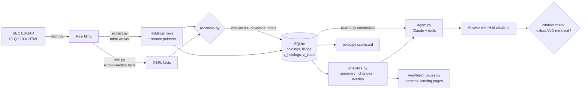

# Architecture

## Pipeline

| Stage | Module | What it guarantees |
|---|---|---|
| Fetch | `fetch.py` | Ticker → CIK → latest 10-Q/10-K, with the User-Agent and rate limit the SEC requires |
| Extract | `extract.py` | One row per holding, from any layout: header keywords instead of fixed column positions, colspan-aware grid, "$" and dash handling, carried-down names, section rows, subtotals skipped, split tables, footnote markers resolved to their text |
| Derive | `extract.py` | `spread_bps` + `base_rate` (both `S + 5.50%` and `SOFR + 550` styles), `mark` = fair value ÷ cost, `lien`, `non_accrual` / `pik` from footnotes, `company_key` for matching borrowers across funds |
| Cross-check | `xbrl.py`, `reconcile.py` | (1) the fact tagged on the cell read as fair value must be a fair-value fact with the same value after scaling, which catches wrong column mappings and units mistakes; (2) every tagged investment must appear in the extraction (missed rows); (3) extracted total = tagged total |
| Store | `db.py` | Typed columns, whole-dollar views (`v_holdings`), latest-filing view (`v_latest`), reconciliation saved per filing |
| Analyze | `analytics.py` | Lien mix, concentration, industry mix, weighted spread and rate, non-accrual (% of FV and cost), PIK, mark buckets, watchlist, maturity wall; quarter-over-quarter new / exited / re-marked / resized; cross-fund mark dispersion |
| Answer | `agent.py` | Tool use over the Messages API; tools are read-only (`run_sql` on a `mode=ro` connection, analytics tools, `get_sources`); each answer's citations are checked against the ids the tools actually returned |
| Measure | `evals.py` | Cell-level accuracy against gold rows, XBRL reconciliation, answer accuracy against SQL-computed truth (unit-aware: "$222.3M" = 222,300,000), grounding rate, tokens and latency |

## What real filings required

Running on Golub Capital BDC's 10-Qs (about 24 MB of inline XBRL each) surfaced issues the samples didn't have. Each has a generic fix, not a per-filer rule:

| Real-world issue | Fix |
|---|---|
| Two schedules per filing (current + prior year-end) | Each table is assigned a date from its rows' XBRL contexts; headerless tables inherit; only the report period is kept |
| Page-break tables with no header row | Borrow the nearest schedule header (before or after) whose columns fit, verified by content (names under company, numbers under fair value) |
| Blank header over the issuer column | Issuer = the span left of the first labelled column |
| Spread split across cells, base rates SF/CA/A/E | Text fields join all cells in their span; base-rate map covers SOFR, CORRA, BBSY, EURIBOR, SONIA, Prime |
| "(In thousands)" above each table, after a large hidden XBRL header | Units read from the table's caption, then the XBRL scale, then the whole document |
| Footnote numbers reused in different sections | Definitions read from the block after the schedule, falling back to the whole document |
| Unlabeled numeric subtotals; notes tables with fair value columns | Rows with no words are skipped; a schedule needs a maturity, rate, spread or issuer column |
| Geographic and other non-investment XBRL dimensions | Only investment-identifier dimensions count toward coverage |
| Tranches of the same loan; renamed borrowers | Quarter-over-quarter matching aggregates tranches and pairs likely renames |

## Decisions and trade-offs

- **Header keywords, not per-filer templates.** One extractor generalizes across layouts. The price is occasional new keywords for unusual labels; misses surface in the reconciliation instead of failing silently.
- **XBRL as a second opinion, not the source.** Tagging depth varies by filer, and the visible table is what analysts read, so the table is parsed and XBRL is used to check it. Where a filing has no tags, the report says so.
- **Read-only SQL over retrieval-augmented text.** Numbers come from typed columns, so aggregates are exact and every answer can cite rows. The agent cannot write: the connection itself is read-only, not just the prompt.
- **Citations must be retrieved, not just real.** Checking that a cited id exists isn't enough: a model can cite a real row it never looked at. The agent tracks what each tool returned.
- **Analytics as tools.** Common questions (what changed, who's on the watchlist) go through tested functions, which is cheaper, faster and more consistent than having the model write the SQL each time.

## Tests

`pytest` runs 36 tests in about half a second, with no network:

- **Layout stress suite** (`tests/test_layouts.py`): the same holdings in 9 table layouts, plus millions with negatives and a non-schedule table.
- **Extraction vs gold:** 598 cells across 3 filings and 2 layouts.
- **Tamper tests:** the reconciliation must catch a missed row and a swapped column.
- **Analytics:** quarter-over-quarter changes, dispersion and summary metrics.
- **Agent loop:** a mocked API, read-only enforcement, and flags for fake or unretrieved citations.
- **Outreach pipeline.**
